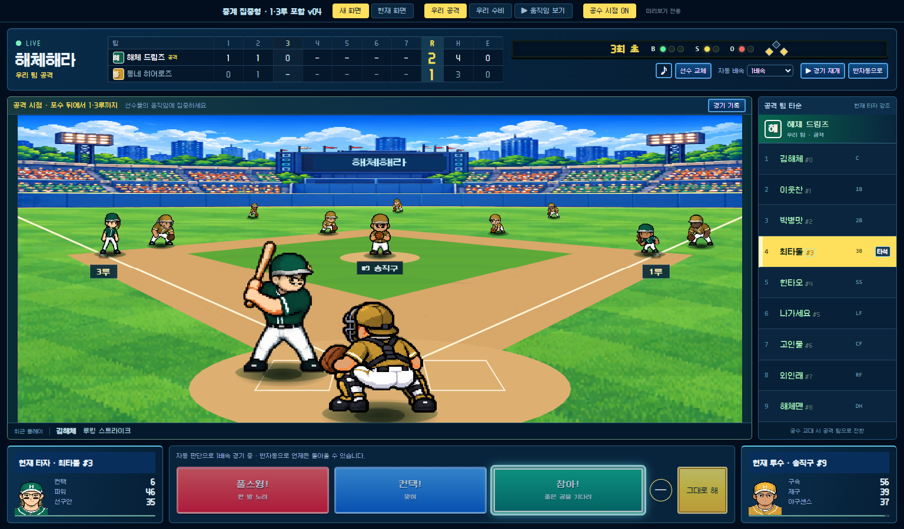

# 해체해라 · 디자인 검토

[현재 디자인 기준 — 2026-11-10 v02](디자인-결정사항-2026-11-10-v02.md)에서 경기장 일체형 배치·누락 정보 복원·시프트/심판 장면과 캐릭터의 현재 방향을 볼 수 있습니다. [당일 v01](디자인-결정사항-2026-11-10-v01.md)과 [11월 9일 기록](디자인-결정사항-2026-11-09-v01.md)은 이전 검토 이력으로 보존했습니다.

## 현재 경기 화면 시안

**[수비 시프트별 공수 장면·심판 포함](수비-시프트-공수-장면-시안-2026-11-10-v01/README.md)**: 전진·좌/후퇴·우를 각각 낮은 공격·높은 수비 시점으로 비교하는 그림4장입니다. 주심·1/2/3루심, 기존 전체 정보와 조작을 남겼습니다. 실제 엔진 좌표를 렌더링한 구현 결과와 구분합니다.

**[경기장 일체형 공격·수비 그림 시안 v02](경기장-일체형-화면-시안-2026-11-10-v02/README.md)**: 경기장 전체 화면, 구장 전광판의 점수·공격 라인업, 잔디 위 얼굴 포함 타자/투수 정보, 작은 판단 지시·경기 기록, 공통 조작부를 함께 표시한 최신 그림 제안입니다. 아래 실행형 v04와 구분하며 실제 게임에는 아직 구현하지 않았습니다.

**[중계 집중형 v04 — 포수 뒤 낮은 시점에 1·3루 포함](중계-집중형-실제게임-시안-2026-11-09-v04/README.md)**



- 상단 점수판과 현재 공격 팀 타순 9명을 계속 표시합니다.
- 공격은 포수 너머 투수 정면을 보는 낮은 시점입니다. 앞쪽 타자·포수의 크기를 유지하며 1·3루 베이스, 주자, 수비수도 화면 안에 둡니다.
- 수비와 타격 후 주루는 경기장 전체가 보이는 높은 구도로 전환합니다.
- 현재 타자·투수 정보와 지시 버튼은 경기장 아래에 둡니다.

게임 원본과 실제 구단 저장을 바꾸지 않는 독립 시안입니다. 실제 배포에는 적용하지 않았습니다. v04가 최종 확정되었다는 뜻은 아닙니다.

## 이전 경기 화면 검토

| 버전 | 검토한 내용 |
| --- | --- |
| [초기 중계 화면](중계-화면-시안-2026-11-09-v01/README.md) | 경기장 위 모서리에 정보를 띄우는 배치 |
| [중계 집중형 v01](중계-집중형-실제게임-시안-2026-11-09-v01/README.md) | 상단 점수판, 오른쪽 공격 타순, 하단 정보·지시 |
| [v02](중계-집중형-실제게임-시안-2026-11-09-v02/README.md) | 같은 각도에서 공격 근접·수비 전체 범위 비교 |
| [v03](중계-집중형-실제게임-시안-2026-11-09-v03/README.md) | 바닥 원근을 바꾼 포수 뒤 낮은 공격 시점 — 사용자가 원하는 구도로 확인 |
| [v04](중계-집중형-실제게임-시안-2026-11-09-v04/README.md) | 낮은 구도를 유지하며 1·3루까지 보이게 조정한 최신 검토본 |

## 캐릭터 시안

**[새 경기장에 캐릭터 임시 배치](경기장-캐릭터-배치-시안-2026-11-10-v01/README.md)**: 6체형 정면 뼈대를 낮은 공격·높은 수비 화면에 올린 크기/간격 비교입니다. 공격·수비 PNG와 기존 선수 비교·크기 조절 미리보기를 보관했습니다. 얼굴·모자·경기 자세는 적용 전입니다.

**[체형별 기본 뼈대 6종](경기장용-체형별-뼈대-2026-11-10-v01.md)**: 보통·단단한 중량·날렵·어깨 넓음·키 큼·작고 단정한형의 정면 비교입니다. 머리카락·모자·눈코입을 비우고 키·체격 차이를 그린 1차 시안이며, 파츠 결합은 아직 시험 전입니다.

**[경기장용 캐릭터 파츠 제작 기준](경기장용-캐릭터-파츠-제작기준-2026-11-10-v01.md)**: 머리카락을 기본 그림에서 분리하고 피부색·눈동자 색을 선수마다 바꾸는 기준을 기록했습니다. 머리카락과 색이 합쳐진 기존 폼 비교본은 제작용 기본 자산과 구분합니다.

**현재는 어제 만든 경기장용 캐릭터에 타자·주자 폼을 적용한 v02를 검토하는 단계입니다.** [기준 캐릭터의 타격 6종·달리기 6종과 시뮬레이터 v02](타격-달리기-폼-시뮬레이터-2026-11-10-v02/README.md)에서 움직임과 6칸 분할동작을 비교할 수 있습니다. 최종 얼굴 파츠·게임용 애니메이션 제작을 확정한 것은 아닙니다. [이전 v01](타격-달리기-폼-시뮬레이터-2026-11-10-v01/README.md)은 별도 코드 캐릭터를 사용해 외형이 달랐으므로 이력으로 보존하고, v02를 현재 비교본으로 사용합니다.

[타자·주자 동작 디자인 — 2026-11-10 v01](타자-주자-동작-디자인-2026-11-10-v01.md)은 비교 시안 제작 전의 의견 기록입니다. 사용자가 제시한 7개 장면, 추가 후보 10개와 미정 사항을 보존했습니다. 이후 능력치·개인 폼·성격 표현을 분리하고 폼을 여러 성격이 공유하는 방향을 논의했습니다.

[기존 캐릭터 시안 폴더](캐릭터-리디자인-시안-2026-11-09-v01/README.md)와 [이미지·생성 요청문](캐릭터-리디자인-시안-2026-11-09-v01/이미지도구/)도 보존했습니다.

선수창의 상세 도트와 경기장용 단순 도트를 분리하는 방향을 검토했습니다. 체형·얼굴 조합, 성격별 대기 동작, 타격 후 1루까지 뛰는 분할동작 이미지는 작업 자료이며 최종 게임 자산이나 완성 애니메이션이 아닙니다.

## 경기 화면 실행

6체형을 실제로 배치한 [독립 미리보기](경기장-캐릭터-배치-시안-2026-11-10-v01/README.md)는 `python 시안/경기장-캐릭터-배치-시안-2026-11-10-v01/build-single.py`로 만들 수 있습니다. 최신 전광판 일체형 배치는 그림 단계이며, 이 실행 파일에 적용한 것은 아닙니다. 아래 v04는 앞선 정보 배치의 실행 비교본입니다.

저장소를 내려받은 뒤 루트에서 다음을 실행합니다.

```text
python 시안/중계-집중형-실제게임-시안-2026-11-09-v04/build-single.py
```

생성된 `deployment-output/중계-집중형-실제게임-시안-2026-11-09-v04.html`을 Chrome 또는 Edge에서 엽니다. `우리 공격`, `우리 수비`, `▶ 움직임 보기`로 장면과 전환을 확인할 수 있습니다. 처음에는 1·3루에 주자가 있는 예시 장면을 보여 줍니다.

약 100MB인 단일 실행 파일은 기존 `.gitignore`에 따라 저장소에 넣지 않았습니다. 소스·이미지·생성 방법을 보관하므로 다시 만들 수 있습니다. 빌드 도구가 기존 출력 파일을 보존하도록 중복 파일명 생성을 막는 경우 새 출력 경로를 지정하세요.
