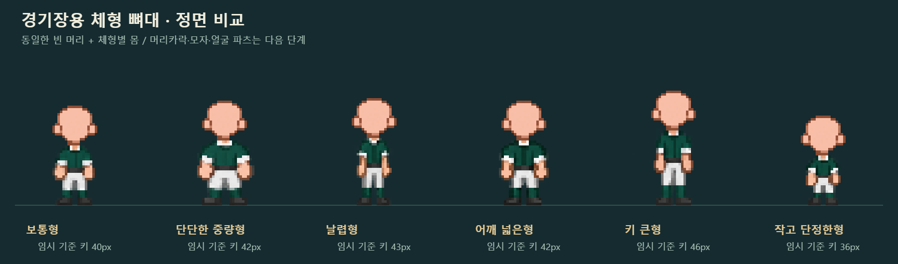

# 경기장용 체형 뼈대 · 방향과 기본 동작 v01

> **이전 실험 이력 — 현재 제작 기준에서 제외.** 기존 캐릭터와 머리 모양·비례가 달라 재검토한 시안입니다. 아래 내용과 수치는 당시 실험 기록입니다. 현재 기준은 [기존 머리를 공유한 6체형 분리본](../경기장용-6체형-머리몸분리-네자세-2026-11-16-v01/README.md)과 [체크리스트 v05](../디자인-제작-체크리스트-2026-11-16-v05.md)입니다.

2026-11-16 · 디자인 체크리스트 몸07.1~몸08.5 작업. **사용자 검토 전인 기본 동작 시안**입니다. 최종 채택·완성 애니메이션·게임 적용과 구별합니다.

먼저 [6체형 정면 비교](6체형-정면비교-v01.png), [대표 8동작 비교](6체형-대표동작-비교-v01.png)를 보세요. [동작 선택·재생 미리보기](경기장용-체형뼈대-비교-v01.html)는 이미지가 포함된 단일 HTML이라 파일을 바로 열 수 있습니다. 동작 24칸 선택, 걷기/달리기/타격 반복, 공통 머리·기준선 켜기를 제공합니다.

## 이번에 만든 범위

체크리스트 순서대로 공통 방향·키·목 기준을 기록하고, 보통형에서 머리 연결을 시험한 뒤 중량형→날렵형→어깨 넓은형→키 큰형→작고 단정한형의 선택 동작을 만들었습니다. 몸 그림은 6체형 × 24칸, 공통 빈 머리는 4방향입니다. 기존 정면6종은 참고로 보존하고 새 동작 그림을 따로 만들었습니다.

| 체형 | 임시 정면 키 | 몸의 차이 | 선택 원본 |
| --- | ---: | --- | --- |
| 보통형 | 40px | 표준 몸통과 팔다리 | [24칸](보통형-몸동작24칸-v01.png) |
| 단단한 중량형 | 42px | 두꺼운 가슴·팔·허벅지, 돌출된 배 배제 | [24칸](중량형-몸동작24칸-v01.png) |
| 날렵형 | 43px | 좁은 몸통과 가는 팔다리 | [24칸](날렵형-몸동작24칸-v01.png) |
| 어깨 넓은형 | 42px | 넓은 상체와 상대적으로 좁은 허리 | [24칸 v02](어깨넓은형-몸동작24칸-v02.png) |
| 키 큰형 | 46px | 긴 몸통과 팔다리 | [24칸](키큰형-몸동작24칸-v01.png) |
| 작고 단정한형 | 36px | 짧은 몸통과 팔다리 | [24칸](작은형-몸동작24칸-v01.png) |

키 수치는 이번 비교용 제안입니다. 사용자 확정값으로 취급하지 않습니다. 키가 달라도 머리 그림·크기는 공통이고, 몸 크기와 목 위치가 달라집니다. 체형·성격·능력치·개인 폼은 별개입니다.

## 몸07.1 · 필요한 방향

공통 머리 원본은 F 정면, FR 오른쪽 앞 사선, BR 오른쪽 뒤 사선, B 뒷모습의 4방향입니다. [머리 4방향](공통-빈머리-4방향-v01.png)의 칸 순서도 같습니다. 몸의 서기 네 칸으로 같은 방향을 비교합니다.

이번 선택 동작에서 걷기·타격·굽힘은 FR, 달리기는 BR을 사용합니다. 반대쪽 이동은 대칭인 빈 뼈대에 한해 반전 재사용 후보입니다. 좌타자 폼, 비대칭 머리카락·안경·아이패치의 좌우 검수 완료를 뜻하지 않습니다. 향후 슬라이딩·넘어짐·위/아래를 보는 동작에 다른 머리가 필요한지는 해당 장면을 만들 때 판단합니다. 경기 전체 방향을 네 개로 영구 제한하지 않습니다.

## 몸07.2 · 키와 발 기준

- 논리 그림 칸은 64×64, 공통 지면은 y58, 가로 기준은 x32입니다. 1배 보기에서 보통형이 실제40px이고 확대는 가장 가까운 픽셀로 표시합니다.
- 정면 서기 여섯 명의 마지막 불투명 픽셀은 y57, 발 아래 경계는 y58입니다. 각각40/42/43/42/46/36px를 유지합니다.
- 체형마다 정면에서 정한 몸 축척을 동작24칸에 똑같이 적용합니다. 굽힌 자세를 서기와 같은 전체 높이로 늘이지 않습니다.
- 머리 가로18×세로16px에는 짧은 목이 포함됩니다. 보통형 약2.5등신의 임시 기준입니다. 먼저 시험한16×18은 길쭉해 보여 이번 비교에서 수정했습니다.
- 걷기/타격은 각 칸의 발 아래를 지면에 두고, 달리기는 가상 지면을 기록해 공중에 뜬 발의 간격을 남깁니다. 최종 달리기의 이동 거리·보폭·속도·발 미끄러짐은 별도 검수입니다.

## 몸07.3 · 머리와 목 연결

머리카락·모자·눈코입 없는 빈 머리 한 벌을 모든 체형이 공유합니다. 몸에는 노출된 목의 윗면만 남겼습니다. 원본 PNG를 지우거나 다시 그리지 않고, 미리보기에서 몸 위에 머리를 합성합니다. 피부색과 눈동자색은 아직 임시이며 변경용 마스크를 만든 단계는 아닙니다.

목 연결은 **그림별 실제 목 기준점 한 곳**을 사용합니다. 머리 그림의 목 아래 중앙을 몸의 목 윗면에 맞추고0.75px 겹칩니다. 접합 여유 폭은6px를 기준으로 합니다. 몸 목의 실제 폭은 체형·동작에 따라 달라 CSV에 별도 기록했습니다. 목 위치 하나를 모든 칸에 강제로 복사하지 않습니다. 머리를 통째로 같은 비율로 키우거나 몸마다 다른 머리로 교체하지 않습니다.

이번 포즈는 몸/팔/배트를 먼저 그리고 머리를 뒤에 합성하는 임시 순서입니다. 머리 앞으로 팔이 지나가는 추가 포즈는 앞팔 레이어 또는 가림 마스크를 별도로 시험해야 합니다. 현재24칸의 확인을 모든 장비·모든 포즈의 호환으로 확대하지 않습니다.

## 몸07.4 · 이동과 기울기 기록

[기준점 JSON](뼈대-기준점-v01.json)에 각 원본 칸·목 좌표·가로 기준·지면·머리 방향·기울기를 저장했습니다. [144칸 기준점 표](체형별-동작-기준점-v01.csv)는 같은 값을 사람이 읽기 쉽게 풀고, 합성 후 목 위치와 목 폭도 적었습니다. 각도 양수는 화면상 시계 방향입니다.

머리 최하단 목 중앙을 중심으로 기울이기 때문에 고개를 숙여도 목에서 떨어져 회전하지 않습니다. 몸의 가로 기준은 체형의 정면 기준으로 유지하고 동작별 목 이동을 따릅니다. 매 칸을 머리 가운데로 다시 정렬하지 않습니다. 타격 일부 칸에서 팔을 목으로 고르는 경우를 발견해 실제 목 후보와 일치하도록 바로잡았습니다.

## 동작 칸 순서

| 칸(1부터) | 내용 |
| --- | --- |
| 1~4 | 정면 / 오른쪽 앞 사선 / 오른쪽 뒤 사선 / 뒷모습 서기 |
| 5~10 | 오른쪽 걷기 6칸 |
| 11~12 | 무릎 굽힘 / 상체 숙임 |
| 13~18 | 오른쪽 달리기 6칸 |
| 19~24 | 우타 기본 준비 / 체중 싣기 / 맞히기 / 스윙 마무리 / 배트 내리기 / 빈손 서기 |

기존 입장·1루·2루 시안의 모든 동작을 다른 다섯 체형에 완성한 것은 아닙니다. 좌타·슬라이딩·베이스 접촉 대기·홈런·삼진 반응·개인별 폼은 각각의 체크리스트에 남깁니다.

## 검사와 남은 것

[전체144칸 합성 검토](6체형-전체동작-검토-v01.png), [렌더 수치](렌더-검사-v01.json)를 보관했습니다.144칸 모두64×64 가장자리에서 잘리지 않았고, 정면6종의 키·발 아래가 위 기준과 일치합니다. HTML의 동작 선택·달리기 재생/정지·공통 머리 끄기/켜기를 확인했습니다. 현재 창 폭에서 가로 넘침은 없었습니다.

GPT 원본에는 완전히 투명한 배경 영역이 있으며 알파를 보존했습니다. 일부 외곽의 낮은 불투명도·미세한 흐림과 원본 픽셀 격자는 최종 자산 제작 전에 정리해야 합니다. 어깨형의 옅은 배경 잔상은 GPT 배경 정리 v02로 보완했고 v01도 이력으로 보존했습니다. 얼굴/피부·유니폼 색 교체·머리카락/모자/안경 가림, 모든 체형의 추가 동작 연결, 실제 경기장 축소 크기와 전체 애니메이션 연속성은 아직 검수 전입니다.

게임 원본 `구현/`, 저장, 경기 판정, 배포는 변경하지 않았습니다. 새 디자인의 실제 게임 적용과 GitHub 업로드도 이번 범위에 포함하지 않았습니다. 사용자 직접 검토는 아직 전입니다.

## 다시 만들거나 이어갈 때

생성에는 **내장 GPT image_gen**을 사용했습니다. [원본 생성 요청문](이미지-요청문-v01.json), [어깨형 배경 정리 요청문](배경정리-요청문-v01.json)을 보관했습니다. 기존6체형 정면은 스타일/체형 참고이고 보통형 몸24칸은 포즈 순서 참고입니다. 특정 기존 게임·만화 캐릭터를 대상으로 삼지 않았습니다.

`build-preview.py`와 `preview-template.html`, `analyze_atlas.py`는 원본 PNG를 읽고 목 후보·공통 머리 합성 미리보기를 다시 만듭니다. PIL/NumPy는 좌표 측정에만 썼고 PNG 픽셀을 편집하지 않았습니다. 생성된 새 원본을 쓸 때는 실제 목 후보를 다시 눈으로 검토해야 합니다. 자동 좌표 분석을 최종 승인으로 취급하지 않습니다.
