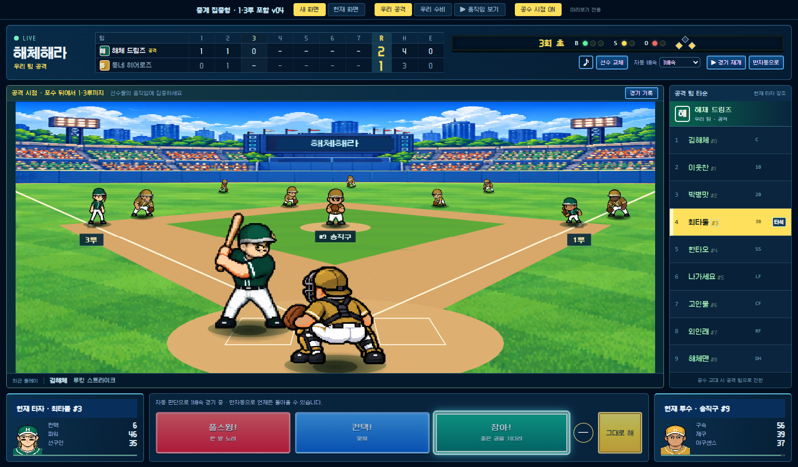

# 해체해라 · 디자인 결정사항과 검토 상태

이 문서는 2026년 11월 9일 이 대화에서 검토한 캐릭터와 경기 화면의 방향을 기록합니다. 실제 구현·배포에 적용된 기능 설명과 시안의 제안을 구분합니다. 별도로 진행 중인 시즌·리그·재화·계약 기획을 확정하거나 변경하는 문서가 아닙니다.

## 현재 상태

| 대상 | 상태 |
| --- | --- |
| 경기 화면의 큰 배치 | 중계 집중형을 선호하는 방향으로 결정. 점수판과 현재 공격 팀 타순을 계속 표시 |
| 공격 카메라 | 포수 너머 투수 정면을 보는 낮고 수평적인 v03 구도를 사용자가 확인 |
| 최신 경기 화면 | 같은 낮은 구도에서 1·3루까지 포함한 v04를 제시. 최종 게임 적용은 아직 확정하지 않음 |
| 수비·타구 카메라 | 외야와 내야 전체, 타구·주루·수비 이동을 보는 높은 구도 |
| 캐릭터 리디자인 | 사용자가 잠시 접어두기로 하여 중단. 최종 그림체·자산 구조 미확정 |
| 게임 원본·배포 | 이 디자인 작업으로 변경하지 않음. 시안은 별도 폴더와 시험용 구단으로 실행 |

## 경기 화면에서 해결할 문제

기존 화면은 경기장 외의 정보가 차지하는 공간이 커서 선수 움직임과 성격별 동작을 보여줄 여지가 작았습니다. 경기장 구도와 정보 배치를 먼저 정하고 캐릭터 작업을 이어가기로 했습니다.

중계 집중형과 감독석형을 비교한 뒤 중계 집중형을 선택했습니다. 대화용 배치 그림 다음에는 현재 게임의 경기장·선수·시뮬레이션을 사용하는 별도 HTML 시안으로 실제 화면을 확인했습니다.

### 유지할 정보와 위치

- **상단:** 이닝별 점수, 합계(R), 안타(H), 실책(E), 볼·스트라이크·아웃과 주자 표시, 경기 진행 버튼.
- **오른쪽:** 현재 공격 중인 팀의 타순 9명만 표시. 우리 공격이면 우리 팀, 우리 수비면 상대 팀으로 바뀌며 현재 타자를 강조합니다.
- **가운데:** 경기장과 선수 움직임. 홈과 베이스 사이를 정보 패널이 가리지 않게 합니다.
- **하단:** 현재 타자, 지시 버튼, 현재 투수 정보.
- **경기 기록:** 필요할 때 열며 공격 팀 타순은 계속 볼 수 있습니다.

점수판 표시는 화면 시안이며 경기의 실제 종료 규칙을 바꾸지 않습니다.

### 공격과 수비의 시점

1. **공격 준비·투구:** 포수 뒤에서 낮게 바라봅니다. 타자와 포수를 앞쪽에 두고 투수의 정면이 가운데 보이게 합니다. 외야·관중석은 낮은 지평선 쪽에 둡니다.
2. **1·3루 표시:** 사용자는 v03의 각도가 생각한 구도와 맞다고 확인하고 1루와 3루도 모두 보이도록 요청했습니다. v04에서는 앞쪽의 구도·선수 크기와 카메라 높이를 유지하며 먼 내야의 가로 표시 범위를 넓혔습니다. 양쪽 베이스, 주자와 수비수가 화면 안에 들어오며 1루/3루 표식을 붙였습니다.
3. **타격·주루:** 실제 타격 순간, 폭투나 주루 상황에는 높은 전체 구도로 중계를 전환합니다. 타구와 주자, 수비수 이동을 보고 다음 투구 준비 때 낮은 구도로 돌아옵니다. 볼·스트라이크마다 전체 화면으로 바꾸지는 않습니다.
4. **수비:** 외야까지 넓게 보여 수비 대형과 선수 이동을 한눈에 봅니다.

점수판·공격 타순·하단 정보의 위치는 카메라가 바뀌어도 유지합니다.

### 시안이 바뀐 과정

| 시안 | 내용과 판단 |
| --- | --- |
| [초기 중계 화면](중계-화면-시안-2026-11-09-v01/README.md) | 경기장을 크게 쓰고 모서리에 정보를 띄우는 이전 검토안 |
| [중계 집중형 v01](중계-집중형-실제게임-시안-2026-11-09-v01/README.md) | 현재 게임 리소스를 사용해 상단 점수판·오른쪽 공격 타순·하단 정보 배치 |
| [v02](중계-집중형-실제게임-시안-2026-11-09-v02/README.md) | 공격은 근접, 수비는 전체 범위로 표시했으나 각도 차이 대신 확대 차이에 그침 |
| [v03](중계-집중형-실제게임-시안-2026-11-09-v03/README.md) | 바닥을 새 원근으로 그리고 기존 경기용 선수 포즈를 새 위치에 배치. 사용자가 낮은 공격 구도를 확인했으나 1·3루는 화면 밖이었음 |
| [v04](중계-집중형-실제게임-시안-2026-11-09-v04/README.md) | 낮은 앞쪽 구도를 유지하고 1·3루까지 포함. 현재 검토할 버전 |

[v03의 공격·수비 비교 이미지](중계-집중형-실제게임-시안-2026-11-09-v03/공수-시점-비교.png)에서도 각도 차이를 볼 수 있습니다.

### 시안의 구현 범위와 확인 결과

- 새 경기장 3D 모델이나 새 선수 자산을 만든 것은 아닙니다. 현재 관중석·경기용 선수 그림을 사용하고, 별도 화면 코드에서 바닥 원근과 표시 좌표를 조정했습니다.
- 낮은 시점의 선수 크기·포즈와 말풍선 위치를 새 좌표에 연결했습니다. 실제 경기 판정과 구단 저장은 원본 게임 엔진의 시험 모드로 처리합니다.
- v04의 정지 장면은 구도를 보기 위한 3회 2:1, 1·3루 주자 예시입니다. 실제 구단의 저장 자료가 아닙니다.
- v04에서 양쪽 주자와 1·3루수의 실제 그림 영역이 화면 안에 들어오는지 확인했습니다. 1366×768과 1280×720에서 화면 넘침 없이 타순 9명이 보였습니다.
- 자동 3배속 경기에서 낮은 시점과 타격 후 전체 구도 전환을 확인했습니다. 확인한 구간에서 수비를 낮은 시점으로 잘못 표시한 경우와 화면 실행 오류는 없었습니다.
- 최종 오프라인 파일에서 실제 저장소 읽기·쓰기 호출이 없고 공격·수비 구도가 전환되는 것을 확인했습니다. 장기 플레이·모든 화면 크기·모든 선수 조합의 검증을 마친 것은 아닙니다.

## 캐릭터에서 검토한 방향

### 목표

선수마다 강점과 성격이 눈에 들어와 애착이 생기는 새 디자인을 원했습니다. 기존 게임·만화 캐릭터를 따라 하지 않으며 작은 경기장 화면에서도 얼굴과 특징이 읽혀야 합니다. 거칠고 투박한 그림체로는 표정이나 성격 동작이 잘 전달되지 않는다는 피드백이 있었습니다.

### 화면별 그림 분리

- **선수창:** 사용자가 제시한 상세 도트 초상화 느낌을 참고해 자연스러운 비례와 얼굴 표현을 검토했습니다.
- **경기장:** 별도의 단순한 작은 전신 도트를 검토했습니다. 선수창 그림을 그대로 2.5등신으로 줄여 쓰는 방식은 원하는 결과가 아니었습니다.
- **체형:** 체형별 키와 비례 차이를 유지해야 합니다. 크고 둥근 체형은 단순히 배가 나온 인상 대신 탄탄한 운동선수 체형으로 보완했습니다.
- **선수 구별:** 같은 체형·성격이라도 얼굴은 선수마다 달라야 합니다. 체형이나 성격만으로 얼굴을 고정하는 것으로 확정하지 않았습니다.

### 조립 구조는 검토 단계

몸의 큰 뼈대를 체형별로 만들고 파츠를 붙이되 동작마다 조각이 어긋나는 문제를 줄이는 방향을 검토했습니다. 선수 생성 시 얼굴 조각을 머리 한 덩어리로 조합하고, 몸 동작에는 목 위치·기울기 같은 연결 기준을 두자는 제안이 있었습니다. 체형별 키가 다르므로 같은 파츠·뼈대를 어떤 범위로 공유할지 확인이 필요합니다.

보통 체형과 얼굴 조합 3명으로 서기·달리기·타격·고개 숙임을 시험하자는 계획이 있었으나, 그림체를 다시 논의한 뒤 캐릭터 작업을 중단했습니다. 이 조립 방식이나 실제 40픽셀 결과를 검증 완료했다고 보지 않습니다. 표정 없이 성격을 표현하는 방안도 최종 확정 사항이 아닙니다.

### 보존한 이미지 자료

[이미지도구 폴더](캐릭터-리디자인-시안-2026-11-09-v01/이미지도구/)에 PNG와 존재하는 생성 요청문을 함께 보관했습니다. 버전별 결과를 덮어쓰지 않았습니다.

| 자료 | 상태 |
| --- | --- |
| A 파워 4자세와 도트 보완본 | 초기 그림체 검토 자료 |
| 체형별 몸·기본 얼굴·섬세한 도트 비교 | 조립과 비례를 보기 위한 그림. 실제 파츠 연결은 미검증 |
| 체형별 기본 얼굴 섬세한 도트 v02 | 두 번째 체형을 탄탄한 운동선수 쪽으로 보완 |
| 선수창용 상세 도트 | 경기장용 그림과 분리한 선수창 방향 검토 |
| 경기장용 단순 도트 보통형 | 작은 전신 도트 방향 검토 |
| 성격별 대기 동작 6종·3칸 | 애니메이션 전의 정지 분할동작 자료 |
| 타격 후 1루까지 6단계 | 열혈·소심·허세 및 느긋·엉뚱·투덜이 2묶음. 뒤 묶음은 v02 보완본도 보존 |
| 사용자 제공 참고 이미지 | 그림체 참고용. 새로 만든 캐릭터나 게임에 적용한 자산으로 분류하지 않음 |

타격·주루 자료는 준비 → 공 맞히기 → 스윙 마무리 → 출발 → 질주 → 1루 통과를 나눠 성격 차이를 보는 정지 그림입니다. 완성 애니메이션이나 게임용 스프라이트 시트로 검증한 결과가 아닙니다. 작은 해상도의 정확한 도트 격자·발 기준점·조립 일치·40픽셀 식별성은 별도 확인이 필요합니다.

**캐릭터의 최종 그림체·등신·파츠 구조는 미확정이며, 현재 작업은 멈춘 상태입니다.** 경기 화면 시안에는 이 새 캐릭터 그림을 적용하지 않았습니다.

## 이어서 검토할 때

1. 경기 화면은 v04에서 양쪽 베이스, 선수 크기, 타격 직후 전환을 먼저 확인합니다.
2. 낮은 시점에서 주자와 투수·타자, 말풍선이 겹치는 상황과 다양한 체형·좌우타자 조합을 더 봅니다.
3. 경기 화면 적용 여부를 정한 뒤, 사용자가 캐릭터 작업을 재개하면 새 경기장 구도에 필요한 선수 방향과 도트 크기를 함께 정합니다. 작업 중단을 임의로 해제하지 않습니다.

실행 방법과 전체 파일 안내는 [시안 목차](README.md)를 참고하세요. 약 100MB인 단일 실행 파일은 저장소에 넣지 않고 소스와 빌드 도구로 다시 만들도록 했습니다.
