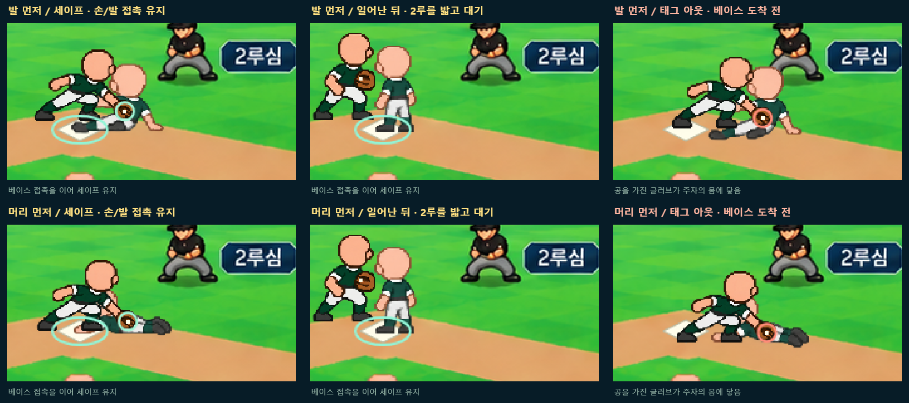

# 보통 체형 · 2루 진루와 슬라이딩

현재 선택본은 [단일 HTML v03](보통체형-2루진루-슬라이딩-미리보기-v03.html)입니다. 파일을 열어 결과(세이프/태그 아웃), 슬라이딩(발 먼저/머리 먼저)을 고르고 재생합니다. 시간 막대·8단계 버튼·0.5배 재생·접촉 확대를 사용할 수 있습니다.



## 이번에 만든 흐름

1루를 밟은 타자주자가 2루까지 추가 진루하는 장면입니다. 1루 대기 → 출발 → 2루 진루 → 슬라이딩 준비 → 슬라이딩 → 접촉/태그 → 일어나기 → 대기/진루 종료를 보여줍니다.

| 구분 | 발 먼저 | 머리 먼저 |
| --- | --- | --- |
| 세이프 영상 | [MP4](보통형-2루-feet-safe-v01.mp4) | [MP4](보통형-2루-head-safe-v01.mp4) |
| 태그 아웃 영상 | [MP4](보통형-2루-feet-out-v01.mp4) | [MP4](보통형-2루-head-out-v01.mp4) |
| 세이프 8단계 그림 | [PNG](feet-safe-sheet-v02.png) | [PNG](head-safe-sheet-v02.png) |
| 아웃 8단계 그림 | [PNG](feet-out-sheet-v02.png) | [PNG](head-out-sheet-v02.png) |

세이프는 발끝 또는 손바닥이 먼저 베이스에 닿고, 접촉을 이어 일어난 뒤 한 발을 베이스에 둔 채 기다립니다. 머리 먼저 슬라이딩은 손→무릎을 당기는 자세→손·발 교대→서기로 연결합니다. 아웃은 베이스 접촉 전에 태그를 받고, 베이스 앞에서 몸을 일으켜 진루를 끝냅니다.

## 포구만으로 아웃이 되지 않는 이유

이번은 강제 진루가 아닌 타자주자의 추가 진루입니다. 두 경우 모두 4.80초에 수비수가 먼저 공을 확보합니다. 세이프 예시는 5.70초에 베이스를 터치한 뒤 6.00초에 태그를 받습니다. 아웃 예시는 베이스 도착 전 5.15초에 태그를 받습니다. 공을 확보한 글러브가 베이스에서 떨어진 주자에게 실제 닿는 사건을 비교하며, 먼저 공을 받았다는 사실만으로 아웃을 표시하지 않습니다. 기준은 [MLB 공식 규칙 2025판의 TAG 정의와 5.09(b)(4)](https://mktg.mlbstatic.com/mlb/official-information/2025-official-baseball-rules.pdf)입니다.

베이스 좌표는 (838,480), 첫 접촉은 베이스 안쪽 가장자리 (848,482)이며 접촉 후 중앙으로 옮깁니다. 자세마다 눈에 보이는 신발/손바닥의 좌표를 따로 지정했습니다. 머리 먼저 일어나는 손·발 교대 자세는 발을 (848,480)에 두고 이어갑니다. 세이프 회복 전 구간에서 접촉점이 베이스 범위 안인지 확인했습니다. 아웃은 진행률 0.9637에서 멈춰 발/손이 베이스에 닿지 않습니다.

태그 글러브는 태그 순간 주자 몸통의 지정점에 맞춥니다. 실제 게임 연결 시에는 이미 확정된 경기 사건과 이동 시간을 받아 표현해야 합니다. 이 시안의 정해진 시간이나 화면 좌표를 실제 경기 판정으로 쓰지 않습니다.

## 사용 그림과 제작 방식

- [2루 주루·슬라이딩 24칸](보통형-2루동작24칸-v01.png): 새 보통형을 참조해 왼쪽 달리기, 발 먼저/머리 먼저 슬라이딩, 접촉·일어나기를 그렸습니다. 1536×1024, 6열×4행입니다. 실제 재생에는 흐름에 맞는 칸을 선택했습니다.
- [2루수 포구·태그 8칸](2루수-포구태그8칸-v01.png): 공 받기, 낮은 태그, 회복 동작입니다. 생성 원본은 1774×887이며 4열×2행 비율로 읽습니다.
- [경기장 배경](경기장-2루주루-배경-v01.png): 이전 높은 주루 시점에서 동적 2루수/우익수 자리를 비우고 2루심을 주로 위 잔디로 옮겼습니다. 점수판·공격 라인업·얼굴 포함 선수 정보·경기 기록·현수막·4심을 유지했습니다.
- 서기와 우익수 포구·송구는 기존 [보통형 동작](보통형-동작24칸-v02.png), [수비 동작](수비-포구송구6칸-v02.png)을 재사용했습니다. 우익수는 좌우를 반전해 2루 방향으로 던집니다.

새 그림 3장은 **내장 GPT 이미지 도구**로 만들었습니다. [최종 생성 요청문 세트](생성-요청문.json)를 보관했습니다. 투명 자산의 알파(투명도)를 유지해 합성하며, 이미지 생성 원본을 후처리로 다시 그리거나 다른 코드 캐릭터로 대체하지 않았습니다.

기본 머리는 머리카락·모자·눈코입 없이 비웠습니다. 피부/유니폼은 임시 공통색이며 피부색·눈동자 색 교체와 얼굴/장비 파츠 결합은 이번에 넣지 않았습니다. 동작과 연결을 비교하는 시안으로, 최종 40px 격자 정리와 전체 방향별 제작은 후속입니다. 접촉 확대창과 색 테두리는 검토용으로 끌 수 있습니다.

## 확인한 내용

- [태그 조건 검사](tag-rules.test.cjs): 선포구 단독 아웃 금지, 공 확보·실제 태그·베이스 이탈 조건, 빈 글러브/공 미확보/태그 전 판정 금지, 도착 뒤 태그 세이프, 뒤늦은 베이스 도착으로 아웃 취소 금지 등 13개 검사.
- [브라우저 4조합·40시점](browser-checks-v01.json), [세이프 접촉 0.01초 간격 862개 검사](contact-checks-v01.json). [접촉점 픽셀 검사](check-contact-pixels.py)는 12개 신발/손바닥 기준점이 실제 불투명한 그림 안인지 확인합니다.
- [저장 영상 4개 재생](video-checks-v01.json): 1280×720, 약 10.9초, 디코딩 오류 없음. 세이프 종료의 베이스 점유와 아웃 종료의 베이스 앞 정지를 화면으로 확인했습니다.
- 첫 HTML v01, 확대창 보완 v02와 이전 그림 v01도 이력으로 보존했습니다. 현재는 HTML v03 / 분할 그림 v02를 봅니다.

## 소스와 다시 만들기

[소스 HTML](index.html), [동작·합성](preview.js), [태그 조건](tag-rules.js), [스타일](preview.css), [단일 파일 생성 도구](build-single.py)를 함께 저장했습니다. 이 폴더에서 아래 명령으로 검사하고 새 이름으로 다시 만들 수 있습니다.

```text
node tag-rules.test.cjs
python check-contact-pixels.py
python build-single.py 새미리보기-v04.html
```

기존 이름은 덮어쓰지 않습니다. [이전 1루 시안](../보통체형-타격주루-경기장-미리보기-2026-11-11-v02/README.md)도 보존합니다. 게임 원본 구현/, 구단 저장, 배포는 변경하지 않았습니다. 사용자 채택 전의 독립 시안입니다.
