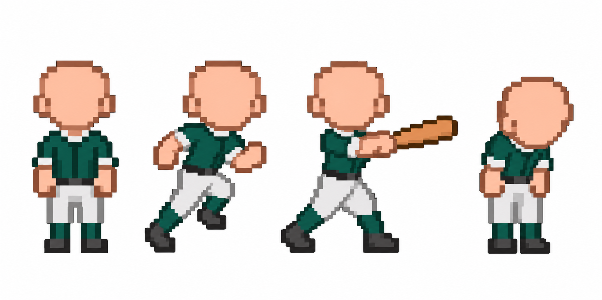

# 기존 보통형 비례 · 네 자세 재검토

2026-11-16 · **사용자 확인 전**. 이번에는 보통형의 서기·달리기·타격·고개 숙임만 다시 보여줍니다. 다른 다섯 체형의 제작은 이 결과 확인 후 진행합니다.

**[네 자세 PNG](보통형-기존비례-네자세-v03.png)** · **[기존 원본과 비교하기](보통형-원본과-네자세-비교-v01.html)**

## 유지할 기준

- 기준은 [기존6체형 원본](기존-6체형-기준원본.png)의 맨 왼쪽 보통형입니다. 넓고 낮은 빈 머리, 계단형 윤곽과 귀, 짧은 목, 몸통·팔다리 비율을 참조했습니다. 최근 새로 만든 공통 머리18×16 규격은 사용하지 않았습니다.
- 기존 보통형 타격·주루24칸은 달리기와 타격 자세 참고로만 사용했습니다. 다른 체형이나 다른 캐릭터 디자인은 새로 만들지 않았습니다.
- 머리카락·모자·눈코입은 비웠습니다. 피부와 눈 색을 선수마다 바꾼다는 계획은 유지되며, 이번에는 색 교체용 마스크를 제작하지 않았습니다.
- 그림에는 머리와 몸이 연결된 완성 모습을 표시합니다. 추후 선수의 얼굴·머리카락·장비를 먼저 조합하고 머리 한 덩어리를 몸의 목에 붙이는 제작 방향은 유지합니다. 이번4자세가 최종 분리 파츠나 골격 데이터 완성본인 것은 아닙니다.

## 이번 수정

내장 GPT image_gen 참조 편집으로 보통형만4자세를 만들었습니다. 첫 결과의 마지막 자세가 옆으로 기울인 모습에 가까워 앞쪽으로 고개를 숙이도록 수정했습니다. 투명 수정본에 배경 잔상이 생겨 사용자가 허용했던 흰 단색 대안으로 최종 검토 PNG를 저장했습니다. 최종 게임용 투명 자산은 외형 확인 후 정리합니다.

기존 원본 파일은 보존했습니다. 생성 결과는 원본 픽셀을 그대로 복사한 것이 아니므로 외형의 일치 여부는 **원본과 나란히 보고 사용자가 확인할 단계**입니다. 원본의 머리만 따로 찌그러뜨리거나 모든 자세를 같은 전체 높이로 강제하지 않았습니다.

비교 HTML은 기존 정면과 새 정면 각각의 전체 키를40px 기준으로 균일 축소하고, 새 달리기·타격·숙임에는 새 정면과 같은 축척을 씁니다. 머리만 따로 크기를 바꾸지 않습니다. 확대와1배 보기를 함께 제공합니다. PNG 자체의 픽셀은 변경하지 않습니다. [표시 좌표와 축척 기준](비교-표시기준.json)을 보관했습니다.

## 이번에 바로잡은 기록

[체크리스트v04](../디자인-제작-체크리스트-2026-11-16-v04.md)에서 몸07.1~.4와 몸08.1~.5를 **부분 시안/자료·재검토 대기**로 되돌렸습니다. 앞서 만든6체형144칸은 외형이 달라진 실험 이력으로 보존하고 현재 제작 기준으로 사용하지 않습니다. 그 실험에서 기록한 키·머리 크기·목 좌표를 원래 캐릭터의 확정 규격으로 간주하지 않습니다.

이번 작업에서 다른 체형 이미지를 추가 생성하거나 수정하지 않았습니다. 게임 `구현/`, 저장, 배포, GitHub에는 적용하지 않았습니다.

## 생성 기록과 확인

- [처음 네 자세 요청과 고개 숙임 수정 요청](입력과-요청문.json)
- [선택 결과와 흰 배경 정리 요청](selected.json)
- `build-review.py`와 `review-template.html`: 비교 HTML 재생성용. Pillow/NumPy는 원본 좌표 측정에만 사용했습니다.
- 확인: 기존 원본1명과 새4자세가 표시되고 전체 PNG가 열림. 현재 브라우저 폭에서 가로 넘침 없음. 확대/1배에 같은 비율 사용. 픽셀 단위 일치·파츠 가림·색 교체·동작의 연속 재생 검수 완료를 주장하지 않습니다.

다음 진행 조건은 사용자가 이 보통형의 머리 모양·비례와 네 자세를 확인하는 것입니다.
