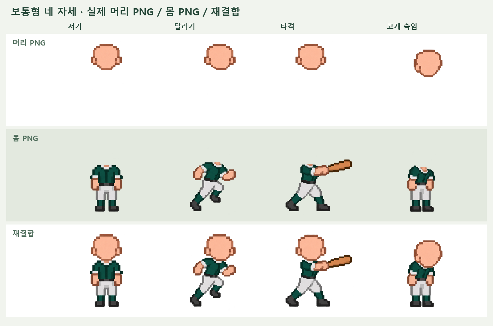

# 보통형 네 자세 · 머리와 몸 실제 분리

2026-11-16 · 사용자가 “왜 머리랑 몸이랑 분리 안 되어 있어?”라고 지적한 누락을 수정했습니다. 직전 네 자세는 머리와 몸이 합쳐진 확인용 통그림이었습니다. 이번에는 실제로 다른 PNG 두 개를 만들었습니다.

**[머리만 PNG](보통형-머리4자세-분리-v01.png)** · **[몸만 PNG](보통형-몸4자세-분리-v01.png)** · **[머리/몸 켜고 끄기](보통형-머리몸-분리확인-v01.html)**

## 파일 구성

- 머리 PNG: 기존 네 자세의 빈 머리와 귀만 남긴 투명 그림입니다. 눈코입·머리카락·모자는 없습니다.
- 몸 PNG: 유니폼·팔·손·다리·신발·배트를 남기고 머리와 귀를 제거했습니다. 목 연결에 필요한 짧은 피부색 목과 옷깃은 몸에 남겼습니다.
- 두 파일 모두1774×887이고 원래 자세 위치를 유지했습니다. 몸을(0,0)에 먼저 그리고 머리를 같은(0,0)에 겹칩니다. 합성할 때 머리를 따로 키우거나 회전하지 않았습니다.
- 왼쪽부터 서기·달리기·타격·고개 숙임입니다. 머리 그림 네 개는 네 자세의 배치이며 네 가지 필수 방향을 확정한 것이 아닙니다. 같은 머리 그림의 재사용/중복 정리는 외형 확인 후 진행합니다.
- [분리 전 통그림](분리전-확인그림.png)은 비교용 원본입니다. 새 원본으로 덮어쓰지 않았습니다.

## 확인한 범위

두 PNG를 실제로 불러와 합성하고, 목 연결과 네 자세를 비교 그림으로 확인했습니다. HTML에서 머리만/몸만/합쳐 보기 버튼과 해당 표시 상태를 확인했습니다. 두 파일의 크기가 같고 투명 영역을 가진 것을 확인했으며, 현재 브라우저 폭에서 가로 넘침은 없었습니다. [크기·알파 확인](원본-크기-알파-확인.json), [버튼 확인](브라우저-확인.json), [배치 기준](분리-배치기준.json)을 보관했습니다.

분리는 내장 GPT image_gen 편집으로 수행했습니다. 생성 편집이므로 원본 픽셀과 완전히 같은 복제본이라고 주장하지 않습니다. 최종 작은 크기의 픽셀 정리·피부/눈동자 색 교체 영역·실제 얼굴/장비의 가림은 아직 확인 전입니다. 현재 파일은 사용자가 보통형의 외형과 분리 방식을 확인할 자산입니다.

## 다음 제작 조건

기존 머리·비례를 유지하고 선수별 눈코입·머리카락·장비를 먼저 조합한 뒤, 머리 한 덩어리를 몸 동작에 붙이는 방향을 유지합니다. 다른 다섯 체형은 이 보통형 확인 뒤 진행합니다. 이번에는 다른 체형을 새로 만들거나 수정하지 않았습니다.

체크리스트v04의 재검토 상태는 그대로 둡니다. 분리 파일이 생겼다는 이유로 전체 파츠 호환이나 모든 체형 제작을 완료 처리하지 않습니다. 게임 구현/·저장·배포·GitHub는 변경하지 않았습니다.

## 생성과 미리보기 재현

[분리 요청문](분리-요청문.json)에 내장 GPT 이미지 도구 모드, 편집 대상과 머리/몸 요청을 기록했습니다. 원본 PNG는 이미지 도구가 만든 그대로 보존했습니다. `prepare.py`는 파일 복사·크기/알파 측정·단일 HTML 생성, `preview-template.html`은 두 파일을 보여주고 합치는 코드입니다. PNG 픽셀을 Python으로 편집하지 않았습니다. 비교PNG는 브라우저의 실제 합성 화면에서 내보냈습니다.
