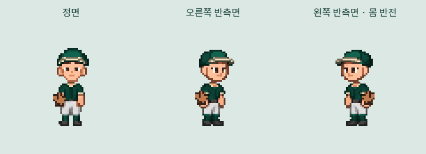

# 수비수 대기 방향 복원 — 2026-11-17

## 기존 결정과 누락 원인

F24의 2026-11-05 규칙은 대기 수비수가 홈을 보도록 정해 두었습니다. 기존 `standingFlip15`도 이를 처리했습니다. 새 `FieldIntegrationV13` 연결이 그 처리를 거치지 않고 모든 대기 수비수에게 앞사선 서기 1번과 기본 반전값을 지정해 규칙이 누락됐습니다.

## 있는 그림과 없는 그림

- 정면 서기 0번, 오른쪽 앞사선 서기 1번, 옆 2번, 뒤사선 3번, 뒤 4번은 6체형 모두 있습니다.
- 왼쪽 앞사선 몸은 오른쪽 몸의 좌우 반전입니다. 머리·헤어·모자·액세서리는 FL 방향 파츠를 선택합니다. 왼쪽 몸을 별도로 그렸다는 뜻이 아닙니다.
- 기존 5번은 타자/주자의 리드 자세입니다. 정면·좌우 반측면의 수비 준비 전용 자세가 모두 완성된 상태가 아닙니다.
- 투구·포구·송구의 모든 방향별 전용 동작이 완성됐다는 뜻도 아닙니다. 기존 제작 체크리스트의 수비 후속 범위와 구별합니다.

## 이번 수정

대기(`idle`, `ready`) 수비수의 현재 좌표에서 홈까지의 방향으로 정면/좌우 앞사선 **몸 전체**를 선택합니다. 홈 중앙 부근은 정면, 좌우 야수는 안쪽 반측면입니다. 시프트 이후에도 현재 위치를 다시 평가합니다. 머리만 반대편으로 돌리지 않습니다.

달리기·포구·송구·타격은 이번 대기 방향 처리의 대상이 아닙니다. 기존 이동 방향·포수 뒤 방향·좌타 방향·주루 판정·외형·유니폼 배색을 유지합니다. 수비 준비 전용 그림이 갖춰지기 전까지 대기는 기존 서기 그림을 사용합니다.

## 검수

- 6체형 × 9시프트 × 공격/수비 두 카메라 = 108배치, 투수 포함 일반 수비수864건의 홈 방향 확인.
- 포수 뒤 방향, 달리는 수비수의 기존 이동 방향, 좌타자 반전 유지 확인.
- 내부 게임 검사19/19, 자산124개 해시·문법·웹빌드 통과, 런타임 오류0.
- 실제 공격/수비 캔버스와 세 방향 서기 비교를 육안 확인. 전용 수비 동작의 미술 승인이나 전체 동작 검수로 확대 해석하지 않습니다.

## 수비 준비 자세 제작 체크

- [x] 기존 서기 방향 자산 유무 확인: 정면/오른쪽/반전 왼쪽, 6체형.
- [x] 기존 대기 홈 방향 규칙 복원 및 두 카메라·시프트 검사.
- [ ] 정면 수비 준비: 무릎을 굽히고 글러브를 앞에 내민 전용 몸 자세.
- [ ] 오른쪽 반측면 수비 준비: 서기·리드와 구별되는 전용 몸 자세.
- [ ] 왼쪽 반측면 수비 준비: 반전 사용 여부와 글러브 착용 손·팔 가림 확인.
- [ ] 세 방향에서 같은 선수의 얼굴/머리/모자·목 연결·40px 가독성 확인.
- [ ] 보통형 확인 후 나머지 5체형에 전개, 대기→첫발→이동 연결 확인.

이번에는 원본 그림을 추가 생성하거나 기존 원본을 수정하지 않았습니다.

## 배포

사이트 v20에 반영했습니다. 소스 `f28c42e5f81684dabb443ff8d4da3e4fece7af01`. 기존 공개 범위 유지, 공개 탭에서 새 방향 함수 로드와 오류0 확인. 배포기록-v20.json 참조.
