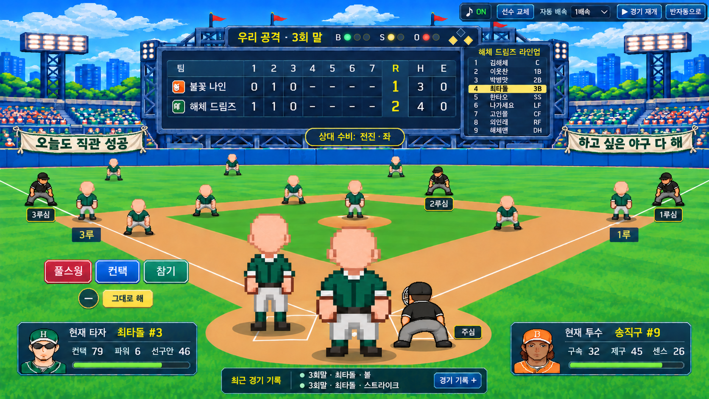
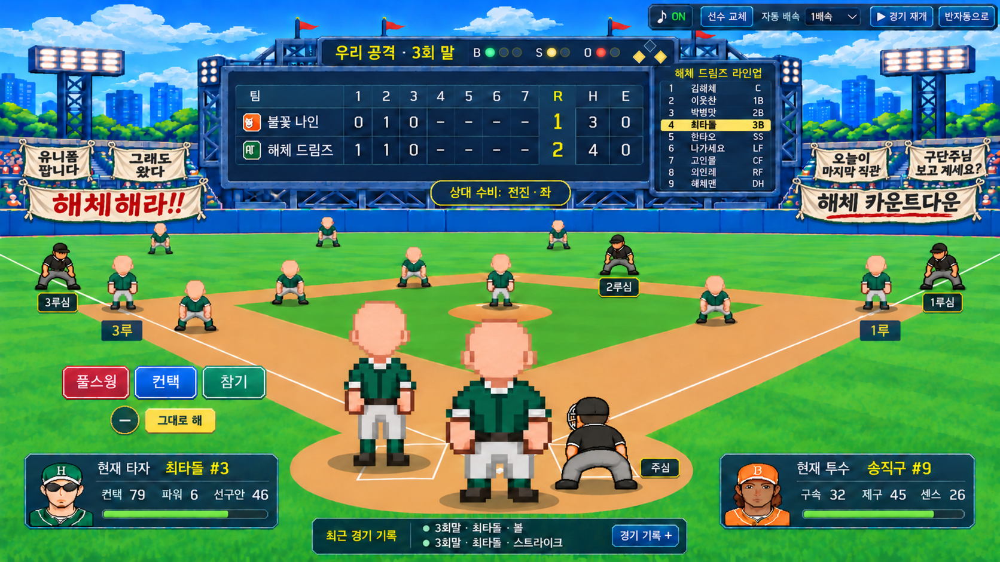
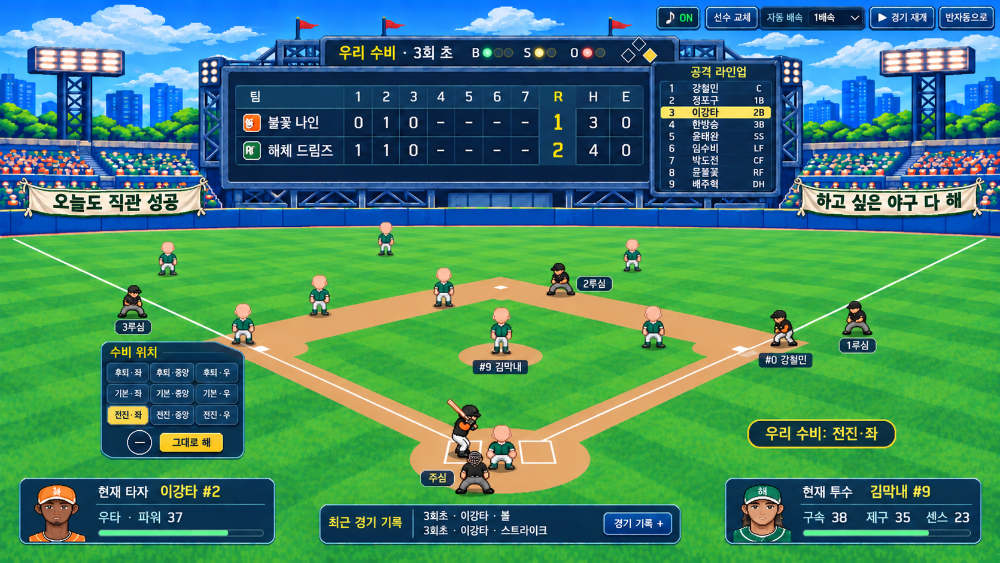
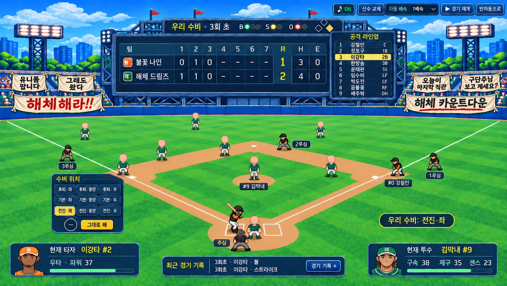

# 해체 여론 현수막 · 공수 화면 시안 · 2026-11-11 v01

**상태: 현수막 배치·표현 방향 사용자 채택(2026-11-11) · 게임 미적용.**

사용자는 공수·4심 화면의 **평온 2장 / 해체 직전 6장** 비교 그림을 보고 “좋다. 현수막은 이 방향으로 하고”라고 정했습니다. 시안과 문구 추가 방식도 GitHub에 기록하도록 요청했습니다. [현재 디자인 기준](../디자인-결정사항-2026-11-11-v01.md)과 [문구 추가 방식](현수막-문구-추가-방식-v01.md)에 채택 방향·남은 제작·추가 절차를 구분했습니다.

## 그림과 생성 요청문

| 카메라 | 평온 예시 · 여론20% | 해체 직전 예시 · 여론95% |
| --- | --- | --- |
| 낮은 공격 시점 | [공격 그림](공격-평온-현수막-v01.png) · [요청문](공격-평온-현수막-v01-생성요청문.txt) | [공격 그림](공격-해체직전-현수막-v01.png) · [요청문](공격-해체직전-현수막-v01-생성요청문.txt) |
| 높은 수비 시점 | [수비 그림](수비-평온-현수막-v01.png) · [요청문](수비-평온-현수막-v01-생성요청문.txt) | [수비 그림](수비-해체직전-현수막-v01.png) · [요청문](수비-해체직전-현수막-v01-생성요청문.txt) |

여론 숫자는 비교를 위한 예시이며 실제 구단 저장 값이 아닙니다. 이번에는 홈경기의 우리 응원석 배치 예시만 그렸습니다.

## 공수 비교 그림

| | 평온 · 2장 | 해체 직전 · 6장 |
| --- | --- | --- |
| 공격 |  |  |
| 수비 |  |  |

## 배치와 문구

전광판 양옆의 관중석 난간에 한쪽당 작은 자리2곳과 넓은 자리1곳, 모두6곳을 잡았습니다. 평온은 아래쪽 긴 현수막2장만, 해체 직전은 위쪽 작은4장까지 사용합니다. 끈·접힌 천·처진 아래선을 넣어 관중석에 매단 소품처럼 표현합니다.

- 평온: 왼쪽 **오늘도 직관 성공**, 오른쪽 **하고 싶은 야구 다 해**.
- 해체 직전 왼쪽: **유니폼 팝니다**, **그래도 왔다**, **해체해라!!**.
- 해체 직전 오른쪽: **오늘이 마지막 직관**, **구단주님 보고 계세요?**, **해체 카운트다운**.

문구와 단계별 개수안은 최근 기획 정리본의 [여론 문구 v01](https://github.com/Kina2002/haechehaera-submission/blob/1b1f07a75e51c56b68a3aecddcdb0b9f20f810ce/구현/해체해라-2026-10-07-v01/문서/관객-반응/해체-여론-문구-2026-11-10-v01.md)을 참고했습니다. 이번에는 관중석 난간의 배치와2장/6장의 표현 방향을 채택했습니다. 실제 크기·최소 글자 크기와 중간 단계의 그림은 적용 과정에서 확인합니다.

## 기존 화면과의 관계

[공수·시프트·심판 시안](../수비-시프트-공수-장면-시안-2026-11-10-v01/README.md)의 공격-전진좌-심판포함-v02.png와 수비-전진좌-심판포함-v01.png를 편집 원본으로 사용했습니다.

- 전광판 점수7이닝/RHE와 현재 공격 라인업9명, 이닝/BSO/주자 표시 유지.
- 소리·선수교체·자동배속·경기재개·반자동 조작 유지.
- 타자·투수 얼굴/정보/체력, 판단 버튼·타이머·그대로 해, 최근 기록2줄·경기 기록+ 유지.
- 선수·주심/각 루심4명·선택된 전진좌 시프트와 공수 카메라 유지 요청.
- 공격과 수비의 관중석에서 같은 문구·같은 난간 자리를 사용.

원본 공수 그림의 경기 배치나 캐릭터 자세를 재설계한 작업은 아닙니다. 생성 편집이므로 원본과 픽셀 단위로 동일함이나 실제 게임 좌표·카메라·가림을 검증한 결과로 보지 않습니다.

## 문구가 늘어날 때의 구현 방향

이번 PNG는 **천과 글자가 함께 그려진 정지 그림**입니다. 교체 기능이나 빈 천 파츠를 구현·제작한 상태는 아닙니다. 실제 적용 시에는 다음처럼 분리합니다. 구체적인 목록 항목·추가 순서·경기 중 유지 기준은 [문구 추가 방식](현수막-문구-추가-방식-v01.md)에 기록했습니다.

1. 도트 천 소품: 짧은형·넓은형 등 몇 가지를 재사용.
2. 문구 목록: 고유번호·문장·여론 단계·권장 현수막 크기·허용 줄바꿈을 기록.
3. 표시: 현수막의 글자 영역에 맞춰 문구를 그립니다. 긴 글은 최대2줄로 나누고, 최소 글자 크기보다 작아지면 넓은형으로 바꾸거나 문구를 다듬습니다. 끝없이 글자를 줄이거나 글을 잘라 숨기지 않습니다.
4. 경기 시작 때 문구와 자리를 정해 저장하여 공수 전환·새로고침 뒤에도 유지. 경기 뒤 변한 여론은 다음 경기의 현수막에 반영.
5. 원정은 따라온 우리 팬 구역만 사용. 우리 원정 관객이0명이면 우리 현수막도 생략.

이 구조를 구현하면 천 소품을 다시 그리지 않고 문구 목록을 추가할 수 있습니다. 임의 길이의 문구가 항상 들어가는 것은 아니므로 실제 화면에서 길이·줄바꿈 검사를 해야 합니다.

## 생성·저장·확인

내장 GPT 이미지 도구를 사용했습니다. 공격 평온은 기존 공격 그림 편집, 공격 해체 직전은 공격 평온을 편집했습니다. 수비 평온은 기존 수비 그림을 편집하고 공격 평온을 천/문구 참고로 사용했습니다. 수비 해체 직전은 수비 평온을 편집하고 공격 해체 직전을 천/문구 참고로 사용했습니다. 각 최종 요청문은 같은 폴더에 저장했습니다.

네 그림에서 현수막2/6장과 문구, 난간 위치, 주요 정보와4심이 보이는지 육안 대조했습니다. PNG4개 무결성, 생성 원본과 저장본의 바이트 일치, 이 README의 상대 링크를 확인했습니다. 공격2장은1672×941, 수비 평온은1671×941, 수비 해체 직전은1670×941입니다. 도구의 출력 크기를 그대로 보존해 별도 이미지 가공을 하지 않았습니다.

게임 원본 구현/, 기존 그림·미리보기 HTML·실제 저장·GitHub·배포는 바꾸지 않았습니다.
